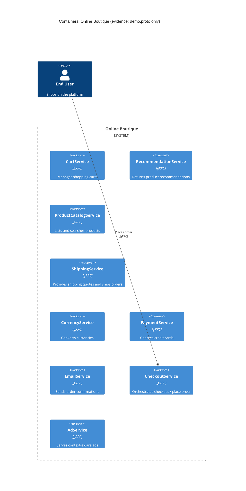

# การกู้คืนสถาปัตยกรรม — Run A

## 1. Agent

Kiro (ขับเคลื่อนโดย Amazon Nova / Auto model, ทำงานภายใน Kiro IDE)

## 2. ไฟล์ที่อ่าน

- `prompts/1-recover-architecture.md`
- `AGENTS.md`
- `system/online-boutique/protos/demo.proto`

## 3. ตาราง Containers

| ชื่อ | เทคโนโลยี / ภาษา | หน้าที่รับผิดชอบ | หลักฐาน |
|---|---|---|---|
| CartService | gRPC service (ไม่ทราบภาษา) | จัดการตะกร้าสินค้า: เพิ่มสินค้า, ดูตะกร้า, ล้างตะกร้า | `demo.proto` — `service CartService` |
| RecommendationService | gRPC service (ไม่ทราบภาษา) | แนะนำสินค้าให้กับผู้ใช้ | `demo.proto` — `service RecommendationService` |
| ProductCatalogService | gRPC service (ไม่ทราบภาษา) | แสดงรายการ, ค้นหา และดึงข้อมูลสินค้า | `demo.proto` — `service ProductCatalogService` |
| ShippingService | gRPC service (ไม่ทราบภาษา) | คำนวณค่าจัดส่งและดำเนินการส่งสินค้า | `demo.proto` — `service ShippingService` |
| CurrencyService | gRPC service (ไม่ทราบภาษา) | แสดงสกุลเงินที่รองรับและแปลงมูลค่า | `demo.proto` — `service CurrencyService` |
| PaymentService | gRPC service (ไม่ทราบภาษา) | เรียกเก็บเงินจากบัตรเครดิต | `demo.proto` — `service PaymentService` |
| EmailService | gRPC service (ไม่ทราบภาษา) | ส่งอีเมลยืนยันคำสั่งซื้อ | `demo.proto` — `service EmailService` |
| CheckoutService | gRPC service (ไม่ทราบภาษา) | ประสานงานกระบวนการ checkout ทั้งหมด | `demo.proto` — `service CheckoutService` |
| AdService | gRPC service (ไม่ทราบภาษา) | แสดงโฆษณาตามบริบทของผู้ใช้ | `demo.proto` — `service AdService` |

> **หมายเหตุ:** ไฟล์ proto กำหนด 9 services ไม่มีหลักฐานของ frontend, data store หรือ message broker ในไฟล์นี้

## 4. ตาราง Dependencies

ไฟล์ proto กำหนดสัญญา RPC ระหว่าง services แต่**ไม่แสดง**ว่า service ใดเรียก service ใด — ระบุแค่ endpoints ที่เรียกได้เท่านั้น ดังนั้นความสัมพันธ์ผู้เรียก→ผู้ถูกเรียก**ไม่มีหลักฐาน**ใน `demo.proto`

สิ่งที่อนุมานได้จากโครงสร้าง message (ผู้เรียกต้องส่งข้อมูล input ซึ่งบ่งบอกว่ามีข้อมูลนั้น):

| ผู้เรียก | ผู้ถูกเรียก | Protocol | หลักฐาน |
|---|---|---|---|
| ไม่มีหลักฐาน | CartService | gRPC | `demo.proto` — `service CartService { rpc AddItem … rpc GetCart … rpc EmptyCart }` |
| ไม่มีหลักฐาน | RecommendationService | gRPC | `demo.proto` — `service RecommendationService { rpc ListRecommendations }` |
| ไม่มีหลักฐาน | ProductCatalogService | gRPC | `demo.proto` — `service ProductCatalogService { rpc ListProducts … rpc GetProduct … rpc SearchProducts }` |
| ไม่มีหลักฐาน | ShippingService | gRPC | `demo.proto` — `service ShippingService { rpc GetQuote … rpc ShipOrder }` |
| ไม่มีหลักฐาน | CurrencyService | gRPC | `demo.proto` — `service CurrencyService { rpc GetSupportedCurrencies … rpc Convert }` |
| ไม่มีหลักฐาน | PaymentService | gRPC | `demo.proto` — `service PaymentService { rpc Charge }` |
| ไม่มีหลักฐาน | EmailService | gRPC | `demo.proto` — `service EmailService { rpc SendOrderConfirmation }` |
| ไม่มีหลักฐาน | CheckoutService | gRPC | `demo.proto` — `service CheckoutService { rpc PlaceOrder }` |
| ไม่มีหลักฐาน | AdService | gRPC | `demo.proto` — `service AdService { rpc GetAds }` |

**[Inferred]** `CheckoutService.PlaceOrder` รับ `CreditCardInfo`, `Address` และ `user_currency` และ response มี `shipping_tracking_id` กับ `shipping_cost` — บ่งชี้อย่างมากว่าเรียก `PaymentService`, `ShippingService`, `CurrencyService`, `CartService` และ `EmailService` ภายใน อย่างไรก็ตาม นี่เป็นการอนุมานจากโครงสร้าง message เท่านั้น ไม่ใช่หลักฐานการเรียกโดยตรง

## 5. Mermaid Diagram

> diagram แสดง `Rel` เดียวจาก end user ไปยัง `CheckoutService` ในฐานะจุดเข้าที่เป็นธรรมชาติ เส้น `Rel` อื่นทั้งหมดถูกละไว้เพราะหลักฐานไม่เปิดเผย ลูกศร `user → checkout` เดียวนี้เป็น **[Inferred]** จาก `PlaceOrderRequest` ที่รับข้อมูล user/payment/address

## 6. Gaps

| ช่องว่าง | สิ่งที่ขาดหาย | ไฟล์ที่จะช่วยยืนยัน |
|---|---|---|
| ความสัมพันธ์ผู้เรียก→ผู้ถูกเรียก | proto กำหนดสัญญา RPC แต่ไม่บอกว่า service ใดเรียก service ใด | `system/online-boutique/kubernetes-manifests/*.yaml` (env vars เช่น `CHECKOUT_SERVICE_ADDR`) หรือ source files ใน `system/online-boutique/src/` |
| Frontend / UI | ไม่มีการกำหนด frontend container ใน proto | `system/online-boutique/kubernetes-manifests/frontend.yaml` หรือ `src/frontend/` |
| Data stores | ไม่มีการอ้างอิง database หรือ cache ใน proto | `system/online-boutique/kubernetes-manifests/cartservice.yaml` (น่าจะมี Redis address env var) หรือ `src/cartservice/` |
| Message brokers | ไม่มีการอ้างอิง queue หรือ async messaging | source code หรือ k8s manifests |
| ภาษาที่ใช้ implement | proto ใช้ `package hipstershop` และ `option go_package` แต่ไม่ยืนยันภาษาของทุก service | `system/online-boutique/src/<service>/` directories |
| ระบบภายนอก | ไม่มีการอ้างอิง payment gateway, email provider หรือ external API | source code ของ `paymentservice` และ `emailservice` |
