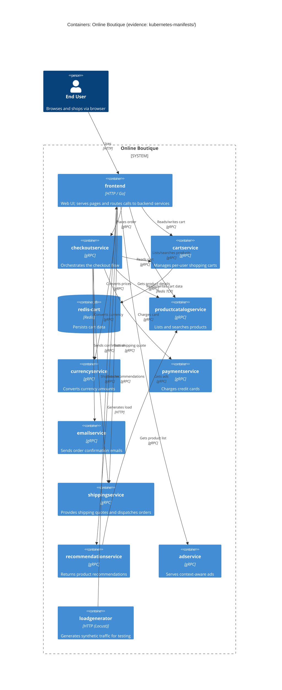

# การกู้คืนสถาปัตยกรรม — Run B

## 1. Agent

Kiro (ขับเคลื่อนโดย Amazon Nova / Auto model, ทำงานภายใน Kiro IDE)

## 2. ไฟล์ที่อ่าน

- `system/online-boutique/kubernetes-manifests/adservice.yaml`
- `system/online-boutique/kubernetes-manifests/cartservice.yaml`
- `system/online-boutique/kubernetes-manifests/checkoutservice.yaml`
- `system/online-boutique/kubernetes-manifests/currencyservice.yaml`
- `system/online-boutique/kubernetes-manifests/emailservice.yaml`
- `system/online-boutique/kubernetes-manifests/frontend.yaml`
- `system/online-boutique/kubernetes-manifests/kustomization.yaml`
- `system/online-boutique/kubernetes-manifests/loadgenerator.yaml`
- `system/online-boutique/kubernetes-manifests/paymentservice.yaml`
- `system/online-boutique/kubernetes-manifests/productcatalogservice.yaml`
- `system/online-boutique/kubernetes-manifests/recommendationservice.yaml`
- `system/online-boutique/kubernetes-manifests/shippingservice.yaml`

## 3. ตาราง Containers

| ชื่อ | เทคโนโลยี / ภาษา | หน้าที่รับผิดชอบ | หลักฐาน |
|---|---|---|---|
| frontend | HTTP (port 8080, LoadBalancer เปิดที่ port 80) | Web UI; จุดเข้าหลักสำหรับผู้ใช้และ load generator | `frontend.yaml` — Deployment `frontend`, Service `frontend-external` (type: LoadBalancer) |
| cartservice | gRPC (port 7070) | จัดการตะกร้าสินค้าของผู้ใช้แต่ละคน | `cartservice.yaml` — Deployment `cartservice`, Service port 7070 |
| redis-cart | Redis / Alpine (port 6379) | เก็บข้อมูลตะกร้าสำหรับ `cartservice` | `cartservice.yaml` — Deployment `redis-cart`, image `redis:alpine` |
| checkoutservice | gRPC (port 5050) | ประสานงานกระบวนการ checkout | `checkoutservice.yaml` — Deployment `checkoutservice`, Service port 5050 |
| productcatalogservice | gRPC (port 3550) | แสดงรายการ, ดึงข้อมูล และค้นหาสินค้า | `productcatalogservice.yaml` — Deployment `productcatalogservice`, Service port 3550 |
| currencyservice | gRPC (port 7000) | แปลงสกุลเงิน | `currencyservice.yaml` — Deployment `currencyservice`, Service port 7000 |
| paymentservice | gRPC (port 50051) | เรียกเก็บเงินจากบัตรเครดิต | `paymentservice.yaml` — Deployment `paymentservice`, Service port 50051 |
| emailservice | gRPC (port 5000 → container 8080) | ส่งอีเมลยืนยันคำสั่งซื้อ | `emailservice.yaml` — Deployment `emailservice`, Service port 5000 |
| shippingservice | gRPC (port 50051) | คำนวณค่าจัดส่งและดำเนินการส่งสินค้า | `shippingservice.yaml` — Deployment `shippingservice`, Service port 50051 |
| recommendationservice | gRPC (port 8080) | แนะนำสินค้า | `recommendationservice.yaml` — Deployment `recommendationservice`, Service port 8080 |
| adservice | gRPC (port 9555) | แสดงโฆษณาตามบริบท | `adservice.yaml` — Deployment `adservice`, Service port 9555 |
| loadgenerator | HTTP client (Locust / busybox init) | สร้าง traffic จำลองไปยัง frontend | `loadgenerator.yaml` — Deployment `loadgenerator`, env `FRONTEND_ADDR=frontend:80` |

> **หมายเหตุ:** `loadgenerator` ถูก comment ออกจาก `kustomization.yaml` สำหรับ production — เป็นเครื่องมือสำหรับพัฒนา/ทดสอบ ไม่ใช่ service ใน production

## 4. ตาราง Dependencies

| ผู้เรียก | ผู้ถูกเรียก | Protocol | หลักฐาน |
|---|---|---|---|
| frontend | productcatalogservice | gRPC | `frontend.yaml` — env `PRODUCT_CATALOG_SERVICE_ADDR=productcatalogservice:3550` |
| frontend | currencyservice | gRPC | `frontend.yaml` — env `CURRENCY_SERVICE_ADDR=currencyservice:7000` |
| frontend | cartservice | gRPC | `frontend.yaml` — env `CART_SERVICE_ADDR=cartservice:7070` |
| frontend | recommendationservice | gRPC | `frontend.yaml` — env `RECOMMENDATION_SERVICE_ADDR=recommendationservice:8080` |
| frontend | shippingservice | gRPC | `frontend.yaml` — env `SHIPPING_SERVICE_ADDR=shippingservice:50051` |
| frontend | checkoutservice | gRPC | `frontend.yaml` — env `CHECKOUT_SERVICE_ADDR=checkoutservice:5050` |
| frontend | adservice | gRPC | `frontend.yaml` — env `AD_SERVICE_ADDR=adservice:9555` |
| checkoutservice | productcatalogservice | gRPC | `checkoutservice.yaml` — env `PRODUCT_CATALOG_SERVICE_ADDR=productcatalogservice:3550` |
| checkoutservice | shippingservice | gRPC | `checkoutservice.yaml` — env `SHIPPING_SERVICE_ADDR=shippingservice:50051` |
| checkoutservice | paymentservice | gRPC | `checkoutservice.yaml` — env `PAYMENT_SERVICE_ADDR=paymentservice:50051` |
| checkoutservice | emailservice | gRPC | `checkoutservice.yaml` — env `EMAIL_SERVICE_ADDR=emailservice:5000` |
| checkoutservice | currencyservice | gRPC | `checkoutservice.yaml` — env `CURRENCY_SERVICE_ADDR=currencyservice:7000` |
| checkoutservice | cartservice | gRPC | `checkoutservice.yaml` — env `CART_SERVICE_ADDR=cartservice:7070` |
| cartservice | redis-cart | Redis (TCP) | `cartservice.yaml` — env `REDIS_ADDR=redis-cart:6379` |
| recommendationservice | productcatalogservice | gRPC | `recommendationservice.yaml` — env `PRODUCT_CATALOG_SERVICE_ADDR=productcatalogservice:3550` |
| loadgenerator | frontend | HTTP | `loadgenerator.yaml` — env `FRONTEND_ADDR=frontend:80` |

> **หมายเหตุ:** `frontend.yaml` มี env `SHOPPING_ASSISTANT_SERVICE_ADDR=shoppingassistantservice:80` ที่ถูก comment ไว้ — service นี้ไม่ได้ deploy ในชุด manifest นี้ จึงระบุไว้ใน **Gaps**

## 5. Mermaid Diagram

## 6. Gaps

| ช่องว่าง | สิ่งที่ขาดหาย | ไฟล์ที่จะช่วยยืนยัน |
|---|---|---|
| ภาษาที่ใช้ implement | k8s manifests ใช้ชื่อ image เปล่า (เช่น `image: frontend`) ไม่มี tag หรือ registry path ทำให้ไม่สามารถระบุภาษา/runtime ของแต่ละ service ได้ | `system/online-boutique/src/<service>/` — เช่น การมีไฟล์ `*.go`, `*.py`, `package.json` จะบอกภาษาได้ |
| `shoppingassistantservice` | env `SHOPPING_ASSISTANT_SERVICE_ADDR=shoppingassistantservice:80` ที่ถูก comment ใน `frontend.yaml` บ่งชี้ว่ามี AI assistant service แต่ไม่มี manifest สำหรับมันในโฟลเดอร์นี้ | `system/online-boutique/kubernetes-manifests/` (ไม่พบไฟล์); ต้องการ manifest แยกหรือ `kustomize/components/shopping-assistant/` component |
| External payment / email providers | manifests แสดง `paymentservice` และ `emailservice` เป็น internal containers — ไม่ทราบว่าเรียก external providers (เช่น Stripe, SendGrid) หรือไม่ | source code ของ `system/online-boutique/src/paymentservice/` และ `src/emailservice/` |
| ความคงทนของ redis-cart | `redis-cart` ใช้ `emptyDir` (ephemeral volume) — ข้อมูลจะหายเมื่อ pod รีสตาร์ท เป็นประเด็นด้านสถาปัตยกรรมที่ยืนยันได้จาก manifest แต่ไม่ทราบว่าตั้งใจให้เป็นแบบนี้หรือไม่ | `cartservice.yaml` แสดงอยู่แล้ว — แต่ ADR หรือ design docs จะอธิบายเจตนาได้ |
| วิธีที่ `adservice` เลือกโฆษณา | manifest ไม่มี external ad network address — ดูเหมือนให้บริการโฆษณาในเครื่องเอง แต่ logic การเลือกไม่ปรากฏ | source code ของ `system/online-boutique/src/adservice/` |
